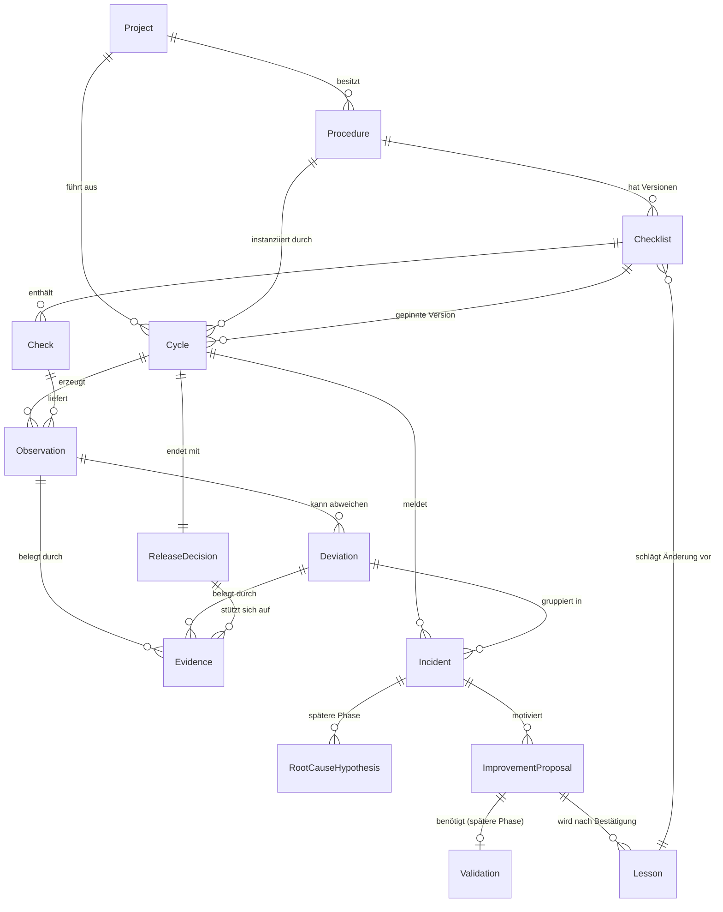
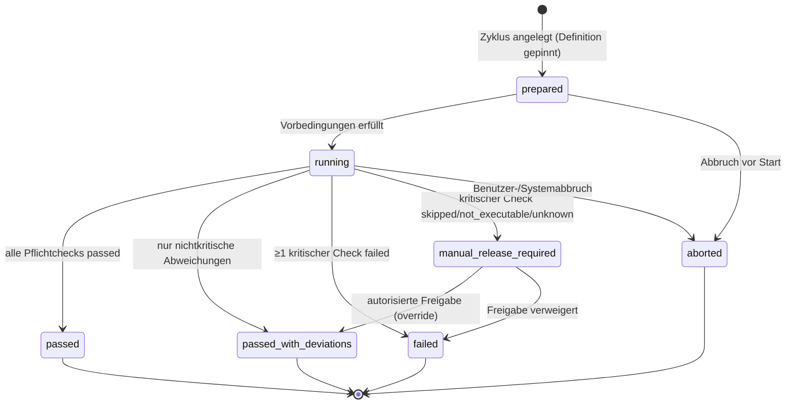
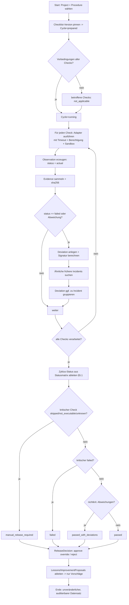

# Kyklos — Analyse & Plan

> 🇬🇧 English (primary/standard) version: [kyklos-analysis-and-plan.md](kyklos-analysis-and-plan.md).
> Diese deutsche Fassung ist eine Übersetzung; bei Abweichungen gilt die englische.
>
> Erstes Planungsdokument. Stand: 2026-10-28. Autor der Vorgaben: Stefan Werfling. Lizenz: MIT.

Dieses Dokument liefert die acht erwarteten Ergebnisse aus der Vorgabe:
Bestandsaufnahme, MVP-Abgrenzung, Domänenmodell, Ablaufdiagramm,
Beispiel-Checkliste, Erfahrungsfall mit Wiederverwendung, Risiken/Sicherheitsgrenzen
und einen priorisierten Implementierungsplan mit Akzeptanzkriterien.

---

## 1. Repository- und Architekturstatus (Bestandsaufnahme)

**Nachweislich vorhanden** (keine Erfindungen):

| Element | Zustand |
|---|---|
| Git | 1 Commit (`ed51521 Initial commit`), Branch `main` |
| Getrackte Dateien | nur `LICENSE`, `README.md` |
| `package.json` | `name: kyklos`, `version: 1.0.0`, `type: commonjs`, kein echtes `test`-Script, **keine Dependencies** |
| `README.md` | 2 Zeilen Stub |
| `LICENSE` | MIT, © 2026 Stefan Werfling |
| `.mcp.json` | `synaipse`-Wissensserver, projektweit auf `kyklos` gescoped |
| `.idea/` | JetBrains-Konfiguration (PHP- und Node-Plugins aktiv), nicht getrackt |
| Tests / Lint / Typecheck / CI | **nicht vorhanden** |
| Quellcode | **nicht vorhanden** — Greenfield |

**Fazit:** Es gibt keine funktionierenden Komponenten, die ersetzt werden müssten.
Wir bauen von Grund auf, orientieren uns aber an den **belegten Konventionen deiner
eigenen Projekte** (siehe unten), statt neue einzuführen.

### Konventionen aus deinen Nachbarprojekten (belegt)

Abgeleitet aus `figtree`, `figtree-schemas`, `flyingfish`, `bambooo`:

- **Sprache/Runtime:** TypeScript 5.7, `strict`, `module: NodeNext`, `target: ES2022`,
  Build nach `dist/` inkl. `declaration` (`.d.ts`).
- **Lint:** ESLint 9 (flat config) mit `@typescript-eslint`, `@stylistic/eslint-plugin-ts`,
  `eslint-plugin-prefer-arrow`, `eslint-plugin-import`.
- **Tests:** Jest (`ts-jest`) in `flyingfish`/`bambooo`, Vitest in `figtree`.
- **Schema/Validierung:** `vts` (Runtime-Typvalidierung, OpenSourcePKG) + `vtseditor`
  zur Schema-Definition — **bereits dein Ökosystem, direkt wiederverwendbar.**

### Name (geklärt)

Das Produkt heißt durchgängig **Kyklos** (griech. κύκλος, „Zyklus"). Der in der
ursprünglichen Vision verwendete Name „Praxis" war ein Fehler und wird nicht verwendet.
Code-/npm-Namespace: `@kyklos/*`.

---

## 2. Technische Grundentscheidungen (Empfehlung) & offene Punkte

| ID | Entscheidung | Empfehlung | Begründung |
|---|---|---|---|
| D1 | Produkt-/Paketname | **geklärt:** durchgängig `kyklos` / „Kyklos" | „Praxis" war Prompt-Fehler |
| D2 | Sprache/Runtime | **geklärt:** TypeScript auf Node 24 (ESM/NodeNext) | deckt sich 1:1 mit deinem Stack |
| D3 | Schema-Layer | **geklärt:** `vts` + `vtseditor` | dein eigenes Tooling, keine neue Abhängigkeit |
| D4 | Persistenz (MVP) | **geklärt:** dateibasierter JSON-Store (append-only Runs, versionierte Definitionen) | deterministisch, diff-/review-bar, git-freundlich |
| D5 | Check-Ausführung | Adapter-Pattern mit `shell`/`http`/`manual` + Deklarations-Checks | austauschbar, sichere Defaults |
| D6 | Testframework | **geklärt:** Vitest | reibungslos mit ESM/NodeNext, bereits in `figtree` genutzt |
| D7 | LLM/Semantik | **nicht im MVP**; Kern deterministisch | Vorgabe Phase 7 |
| D8 | Projektsprache | **geklärt:** Englisch als Standard, Deutsch als Übersetzung (`*.de`) | Nutzervorgabe |

D1–D4, D6, D8 sind bestätigt. D5/D7 sind Entwurf und werden in den jeweiligen
Meilensteinen konkretisiert.

---

## 3. MVP-Abgrenzung

**Im MVP (Phase-8-Liste):**

1. Projekt- & Verfahrensdefinition (`Project`, `Procedure`).
2. Versionierte Checkliste (`Checklist`, `Check`).
3. Deterministische Ausführung von Prüfschritten (Runner + Adapter).
4. Strukturierte Ergebnisse & Nachweise (`Cycle`, `Observation`, `Evidence`).
5. Abweichungs- & Vorfallerfassung (`Deviation`, `Incident`).
6. Einfache Suche nach früheren Vorfällen (Merkmals-/Signatur-Matching, **ohne** KI).
7. Vorschläge für Checklistenverbesserungen (`ImprovementProposal`) — nur Vorschlag, nie Auto-Aktivierung.
8. Nachvollziehbare Freigabeentscheidungen (`ReleaseDecision`).
9. Beispielhaftes Software-Release-Verfahren (Checkliste A–F).
10. Automatisierte Tests für kritische Abläufe (Status-Logik, Gatekeeping, Serialisierung).

**Bewusst NICHT im MVP (spätere Phasen):**

- `RootCauseHypothesis` als eigener Workflow mit Vertrauensstufen-Automatik → im MVP nur als
  **Datenfeld** an `Incident` (freitext + Confidence-Enum), kein eigener Lebenszyklus.
- `Rule` als eigenständig ausführbare, versionierte Engine → im MVP ist ein `Check` die
  ausführbare Einheit; `Rule` wird erst nötig, wenn Checks aus Regeln generiert werden.
- `Validation` als separater Objekttyp → im MVP als **Pflichtfeld an `ImprovementProposal`**
  (ein Vorschlag ohne dokumentierte Validierung bleibt im Status `proposed`).
- `Lesson`-Abstraktion & **projektübergreifende** Übertragung → Datenmodell wird vorbereitet,
  Übertragungs-Workflow kommt in Phase 6 nach dem MVP.
- Verteilte Agenten, Web-UI, KI/semantische Suche, Message-Queues.

**Minimal benötigte Objekte im MVP:** `Project`, `Procedure`, `Checklist`, `Check`, `Cycle`,
`Observation`, `Deviation`, `Evidence`, `Incident`, `ImprovementProposal`, `ReleaseDecision`.
Später ergänzt: `RootCauseHypothesis`, `Lesson`, `Rule`, `Validation` (als eigene Entitäten).

---

## 4. Domänenmodell mit Beziehungen

### 4.1 Identität & Versionierung (Grundprinzip)

- **Definitionen** (`Procedure`, `Checklist`, `Check`, später `Rule`): identifiziert durch
  stabiles `id` **+ `version`** (SemVer-artig oder monoton). Definitionen sind **immutable**;
  eine Änderung erzeugt eine neue Version. Alte Versionen bleiben für Reproduzierbarkeit erhalten.
- **Ereignisse/Läufe** (`Cycle`, `Observation`, `Deviation`, `Evidence`, `ReleaseDecision`):
  **append-only**, unveränderlich nach Abschluss. Identifiziert durch ULID/UUID + Zeitstempel.
- **Integrität:** jede `Evidence` trägt eine **Prüfsumme (sha256)** über ihren Inhalt; ein
  `Cycle` referenziert die exakten **Definitions-Versionen**, mit denen er lief. Dadurch ist
  jedes Ergebnis exakt reproduzier- und auditierbar.

### 4.2 Beziehungsdiagramm (ER)



### 4.3 Objektbeschreibungen

| Objekt | Zweck | Identität | Schlüsselfelder | Lebenszyklus |
|---|---|---|---|---|
| **Project** | Projektidentität & Technik | `id` | name, repoUrl, stack/Tags, policyRefs | dauerhaft, editierbar |
| **Procedure** | wiederverwendbarer Ablauf | `id`+`version` | name, kind (release/backup/…), checklistRef | immutable je Version |
| **Checklist** | versionierte Prüfliste | `id`+`version` | checks[], ruleVersion | immutable je Version |
| **Check** | einzelner Prüfschritt | `id`+`version` | preconditions, action(adapter+args), successCriterion, criticality, expectedEvidence, onFailure | immutable je Version |
| **Cycle** | konkrete Ausführung | ULID | projectRef, procedureRef@ver, state, startedAt/endedAt, results[] | Zustandsautomat (§5) |
| **Observation** | gemessener Ist-Zustand | ULID | checkRef@ver, status, actual, measuredAt, evidenceRefs | append-only |
| **Deviation** | Soll/Ist-Abweichung | ULID | observationRef, expected, actual, severity, signature | append-only |
| **Evidence** | überprüfbarer Nachweis | ULID | type (log/test/checksum/file), uri/inline, sha256, producedBy | immutable |
| **Incident** | zusammenhängender Fehlerfall | ULID | deviationRefs[], classification, signature, status, confidence | open→investigating→resolved |
| **RootCauseHypothesis** *(später)* | mögliche Ursache | ULID | incidentRef, statement, evidenceRefs, confidence (direct/correlation/plausible/confirmed) | proposed→(dis)confirmed |
| **Lesson** *(später)* | bestätigte Erkenntnis | `id`+`version` | scope (project/general), statement, conditions, limits, provenance, validationStatus | draft→validated→published |
| **ImprovementProposal** | vorgeschlagene Änderung | ULID | target (checklist/check), diff, rationale, evidenceRefs, status, validationRef | proposed→validated→accepted/rejected |
| **Validation** *(später eigenständig)* | Wirksamkeitsnachweis | ULID | proposalRef, method, result, evidenceRefs | pending→passed/failed |
| **Rule** *(später)* | deterministisch ausführbare Regel | `id`+`version` | expression, severity | immutable je Version |
| **ReleaseDecision** | Freigabeentscheidung | ULID | cycleRef, outcome (approve/reject/abort), rationale, ruleVersion, decidedBy, overrides[] | immutable |

**Datenintegritätsregeln (invariant):**

1. Ein `Cycle` referenziert **genau eine** gepinnte `Checklist`-Version; nachträgliche
   Checklisten-Änderungen beeinflussen laufende/abgeschlossene Zyklen nie.
2. Jede `Observation` hat **genau einen** Status aus dem Enum in §5.2.
3. Ein `ImprovementProposal` kann den Status `accepted` **nur** erreichen, wenn eine
   `Validation` mit `passed` existiert (im MVP: Pflichtfeld; später: Objekt).
4. Eine `ReleaseDecision` mit kritischer offener `Deviation` ist nur mit explizitem,
   autorisiertem `override` möglich (begründet, signiert, protokolliert).

---

## 5. Prüfzyklus als kontrollierter Ablauf

### 5.1 Zyklus-Zustandsautomat



**Kernregel (Gatekeeping):** Ein **übersprungener, nicht ausführbarer oder unbekannter
kritischer** Prüfschritt führt **niemals** automatisch zu `passed`, sondern mindestens zu
`manual_release_required`. Nicht-kritische Abweichungen führen zu `passed_with_deviations`.

### 5.2 Ergebnisstatus je Prüfschritt (explizit getrennt)

`passed` · `failed` · `skipped` · `not_applicable` · `not_executable` · `unknown`

| Status | Bedeutung | Zählt als bestanden? |
|---|---|---|
| passed | Erfolgskriterium erfüllt | ja |
| failed | Erfolgskriterium verletzt | nein |
| skipped | bewusst ausgelassen | nein (kritisch → Gate) |
| not_applicable | Vorbedingung trifft nicht zu | neutral |
| not_executable | Aktion konnte nicht laufen (Tool fehlt, Timeout) | nein (kritisch → Gate) |
| unknown | Ergebnis nicht eindeutig feststellbar | nein (kritisch → Gate) |

### 5.3 Vollständiger Ablauf eines Prüfzyklus



---

## 6. Beispiel: Release-Checkliste (versioniert, maschinenlesbar)

Auszug einer `Checklist` v1.0.0 für `kind: software-release` (Gruppen A–F).
Format bewusst deklarativ/YAML, projektübergreifend anpassbar über `adapter`-Args.

```yaml
checklist:
  id: release.default
  version: 1.0.0
  ruleVersion: 1.0.0
  checks:
    # --- A. Vorbereitung ---
    - id: prep.target-version
      version: 1.0.0
      group: preparation
      description: Zielversion und Quellstand eindeutig identifizieren
      criticality: critical
      preconditions: []
      action: { adapter: shell, cmd: "git describe --tags --always", timeoutMs: 5000 }
      successCriterion: { kind: regex, on: stdout, pattern: "^v?\\d+\\.\\d+\\.\\d+" }
      expectedEvidence: [stdout]
      onFailure: block

    - id: prep.clean-worktree
      version: 1.0.0
      group: preparation
      description: Git-Arbeitsverzeichnis sauber
      criticality: critical
      action: { adapter: shell, cmd: "git status --porcelain", timeoutMs: 5000 }
      successCriterion: { kind: empty, on: stdout }
      onFailure: block

    # --- B. Backup & Wiederherstellung ---
    - id: backup.create
      version: 1.0.0
      group: backup
      description: Datenbank-Backup erstellen und Ergebnis dokumentieren
      criticality: critical
      action: { adapter: shell, cmd: "${BACKUP_CMD}", timeoutMs: 1800000 }
      successCriterion: { kind: exitZeroAndFileExists, path: "${BACKUP_FILE}" }
      expectedEvidence: [stdout, file:checksum]
      onFailure: block

    - id: backup.verify-integrity
      version: 1.0.0
      group: backup
      description: Integrität des Backups prüfen (Prüfsumme/Testlesen)
      criticality: critical
      preconditions: [backup.create==passed]
      action: { adapter: shell, cmd: "${BACKUP_VERIFY_CMD}", timeoutMs: 600000 }
      successCriterion: { kind: exitZero }
      onFailure: block

    - id: backup.restore-test
      version: 1.0.0
      group: backup
      description: Wiederherstellung in Testumgebung + Konsistenzprüfung
      # Ein erzeugtes Backup ist KEIN Nachweis der Wiederherstellbarkeit.
      criticality: critical
      preconditions: [backup.verify-integrity==passed]
      action: { adapter: shell, cmd: "${RESTORE_TEST_CMD}", timeoutMs: 1800000 }
      successCriterion: { kind: exitZero }
      expectedEvidence: [stdout, test:report]
      onFailure: block

    # --- C. Upgrade ---
    - id: upgrade.migrate
      version: 1.0.0
      group: upgrade
      description: DB-Migrationen von Ausgangs- auf Zielversion ausführen & prüfen
      criticality: critical
      preconditions: [backup.restore-test==passed]
      action: { adapter: shell, cmd: "${MIGRATE_CMD}", timeoutMs: 900000 }
      successCriterion: { kind: exitZero }
      expectedEvidence: [stdout, test:migration-log]
      onFailure: block

    - id: upgrade.smoke-business-flows
      version: 1.0.0
      group: upgrade
      description: Zentrale Geschäftsabläufe + API-Verhalten nach Upgrade testen
      criticality: critical
      action: { adapter: http, request: { method: GET, url: "${BASE_URL}/health" }, timeoutMs: 15000 }
      successCriterion: { kind: httpStatus, equals: 200 }
      onFailure: block

    # --- D. Rollback (Deployment- vs. DB-Rollback vs. volle Wiederherstellung) ---
    - id: rollback.plan-defined
      version: 1.0.0
      group: rollback
      description: Wiederherstellungsstrategie VOR Upgrade festgelegt & irreversible Migrationen markiert
      criticality: critical
      action: { adapter: manual, prompt: "Rollback-Strategie dokumentiert? Irreversible Schritte benannt?" }
      successCriterion: { kind: manualConfirm }
      onFailure: block

    - id: rollback.deployment-test
      version: 1.0.0
      group: rollback
      description: Rückkehr zur vorherigen Anwendungsversion nachweisen (funktionsfähig)
      criticality: critical
      action: { adapter: shell, cmd: "${ROLLBACK_TEST_CMD}", timeoutMs: 900000 }
      successCriterion: { kind: exitZero }
      expectedEvidence: [stdout, test:report]
      onFailure: block

    # --- E. Deployment & Nachkontrolle ---
    - id: deploy.artifact-integrity
      version: 1.0.0
      group: deployment
      description: Artefaktintegrität & Zielversion kontrollieren
      criticality: critical
      action: { adapter: shell, cmd: "sha256sum -c ${ARTIFACT_SHA_FILE}", timeoutMs: 30000 }
      successCriterion: { kind: exitZero }
      onFailure: block

    - id: deploy.healthcheck
      version: 1.0.0
      group: deployment
      description: Healthchecks, Logs, Fehlerquoten, Hintergrundjobs prüfen
      criticality: critical
      action: { adapter: http, request: { method: GET, url: "${BASE_URL}/health" }, timeoutMs: 15000 }
      successCriterion: { kind: httpStatus, equals: 200 }
      onFailure: block

    - id: deploy.error-rate
      version: 1.0.0
      group: deployment
      description: Fehlerquote unter Schwellwert nach Deployment
      criticality: major   # nicht-kritisch -> passed_with_deviations möglich
      action: { adapter: http, request: { method: GET, url: "${BASE_URL}/metrics/errors" }, timeoutMs: 15000 }
      successCriterion: { kind: jsonPathLte, path: "$.rate", value: 0.01 }
      onFailure: warn

    # --- F. Freigabe ---
    - id: release.gate
      version: 1.0.0
      group: release
      description: Pflichtprüfungen auswerten, Restrisiken darstellen, Entscheidung dokumentieren
      criticality: critical
      action: { adapter: decision }
      successCriterion: { kind: allCriticalPassed }
      onFailure: block
```

**Hinweise:** `${…}` sind projektspezifische Parameter aus der `Project`-Konfiguration
(keine Secrets im Klartext in der Checkliste). `criticality: critical` → Gate greift;
`major/minor` → nicht-kritisch. `onFailure: block|warn|escalate` steuert das Verhalten.

---

## 7. Beispiel: Erfahrungsfall mit projektübergreifender Wiederverwendung

**Ausgangsvorfall (Projekt `flyingfish`):**

1. **Deviation:** `backup.restore-test` → `failed`. Erwartet: konsistente DB nach Restore.
   Ist: fehlende Fremdschlüssel-Daten. Evidence: `restore.log` (sha256…), `diff-report.txt`.
2. **Incident-Klassifikation:** `backup/restore`, Technologie `postgres`, Signatur
   `restore-incomplete:fk-constraint`. Ähnliche frühere Incidents: keine.
3. **Ursache (RootCauseHypothesis, Vertrauensstatus getrennt):**
   - *Beobachtung (direct):* Dump wurde mit `--data-only` ohne Reihenfolge-Garantie erstellt.
   - *Plausible Hypothese:* `pg_dump` ohne `--disable-triggers`/falsche Reihenfolge → FK-Verletzung beim Restore.
   - *Korrelation ≠ Ursache:* Der gleichzeitige Node-Upgrade war **nicht** kausal (ausgeschlossen durch Reproduktion).
4. **ImprovementProposal:** Check `backup.create` um `--format=custom` + Restore mit
   `pg_restore --clean --if-exists` ergänzen; neuer Check `backup.restore-fk-consistency`.
5. **Validation (Pflicht vor Aktivierung):** Vorschlag in Testumgebung ausgeführt →
   Restore erfolgreich, FK-Konsistenz `passed`. Erst **danach** Status `validated`.

**Abstraktion zur allgemeinen Lesson (Phase 6):**

```yaml
lesson:
  id: lesson.pg-restore-fk-consistency
  version: 1.0.0
  scope: general
  statement: >
    Logische PostgreSQL-Dumps müssen beim Restore referentielle Integrität
    sicherstellen (custom format + pg_restore --clean, oder Trigger deaktivieren).
    Ein erfolgreicher Dump belegt keine erfolgreiche Wiederherstellung.
  appliesTo: { tech: [postgresql], procedureKind: [software-release, backup] }
  conditions:   # nur übertragen, wenn im Zielprojekt erfüllt
    - "Backup-Mechanismus nutzt pg_dump/pg_restore"
    - "Schema enthält Fremdschlüssel"
  knownLimits:
    - "Nicht relevant für physische Backups (pg_basebackup)"
  provenance: { originProject: flyingfish, incidentSignature: "restore-incomplete:fk-constraint" }
  validationStatus: validated
  excludes: [secrets, credentials, pii, project-internal-hostnames]
```

**Übertragungsregel:** Die Lesson wird Projekt `helionet` nur vorgeschlagen, wenn dessen
`Project.stack` PostgreSQL enthält **und** die `conditions` geprüft bestätigt sind. Übertragen
wird die **abstrahierte Regel**, niemals Secrets, Hostnames oder projektinterne Daten.

---

## 8. Risiken & Sicherheitsgrenzen

| # | Risiko | Grenze / Gegenmaßnahme |
|---|---|---|
| R1 | Übersprungener kritischer Check gilt als bestanden | Harte Gate-Regel §5.1; getestet in kritischen Tests |
| R2 | „Backup erstellt" = „wiederherstellbar" verwechselt | separate Checks `create`/`verify`/`restore-test`, Restore ist Pflicht-Gate |
| R3 | Rollback-Arten verwechselt | Deployment- / DB-Rollback / volle Wiederherstellung sind getrennte Checks |
| R4 | Beliebige Shell-Ausführung (RCE) | Adapter mit **Allowlist**, definierten Berechtigungen, **Timeout**, kontrollierter Ausführungsumgebung; keine impliziten Secrets |
| R5 | Automatisches „Lernen" verändert Freigabekriterien | `ImprovementProposal` → nur Vorschlag; Aktivierung erst nach `Validation` + autorisierter Annahme |
| R6 | KI erteilt Freigabe / verändert Protokolle | **verboten**: keine KI entscheidet Freigaben, ändert Protokolle oder setzt Systeme zurück |
| R7 | Korrelation als Ursache | Vertrauensstufen getrennt (direct/correlation/plausible/confirmed); Reproduktion nötig |
| R8 | Secrets/PII in übertragenen Lessons | `excludes`-Liste, keine Klartext-Secrets, nur abstrahierte allgemeine Regeln |
| R9 | Manipulation von Nachweisen | Evidence immutable + sha256; Runs append-only; Definitionen versioniert/gepinnt |
| R10 | Produktive Systeme durch Kyklos verändert | Default read-only/Testumgebung; schreibende Aktionen nur explizit, autorisiert, protokolliert |

**Nicht-Ziele (Sicherheit):** keine automatische Veröffentlichung, kein Reset produktiver
Systeme, keine eigenständige Freigabe durch Automatik/KI.

---

## 9. Priorisierter Implementierungsplan (mit Akzeptanzkriterien)

> Kleine, überprüfbare Schritte. Jeder Meilenstein liefert Code + Tests + grün in
> `lint`/`typecheck`/`test`/`build`. Keine großflächigen Refactorings.

### M0 — Projekt-Setup (Fundament) ✅ erledigt
- TS-Setup nach deiner Konvention (tsconfig strict/NodeNext/ES2022, `.eslintrc.json`
  wie `figtree-schemas`, Vitest).
- Scripts: `build`, `lint`, `typecheck`, `test`. Ordnerstruktur `src/`, `test/`.
- Zweisprachiges README (`README.md` EN primär, `README.de.md`).
- **Akzeptanz (erfüllt, verifiziert 2026-10-28):** `npm run build`, `npm run typecheck`,
  `npm run lint`, `npm test` laufen grün (Smoke-Test `KYKLOS_VERSION`).

### M1 — Domänenmodell & Serialisierung
- Typen/Schemas (via `vts`) für die 11 MVP-Objekte; JSON-(De)Serialisierung; sha256 für Evidence.
- Dateibasierter Store (append-only Runs, versionierte Definitionen).
- **Akzeptanz:** Round-Trip-Tests (serialize→deserialize identisch); Definition-Versionierung
  immutable; ungültige Objekte werden abgelehnt (Schema-Validierung getestet).

### M2 — Check-Runner & Adapter ✅ erledigt
- Adapter `manual`, `shell` (Allowlist + Timeout, kein Shell-String → strukturierte bin/args),
  `http` (fetch + AbortSignal-Timeout); `SuccessCriterionEvaluator`; `AdapterRegistry`;
  `CheckRunner` (src/Runner). Decision-Adapter nach M3 verschoben.
- Status-Mapping (6 Status) deterministisch; ein nicht ausgeführter/unbekannter Check wird nie passed.
- **Akzeptanz (erfüllt, verifiziert 2026-10-28):** alle sechs Status über Fixtures reproduzierbar;
  Timeout → `not_executable`; nicht-allowgelistetes Binary abgelehnt; Determinismus getestet; 60 Tests grün.

### M3 — Zyklus-Engine & Gatekeeping ✅ erledigt
- `CycleStateResolver` (Gatekeeping), `CycleEngine` (führt Checks aus → Observations/Deviations,
  leitet Status ab, optionale append-only Persistenz; injizierte Clock + IdGenerator für
  Reproduzierbarkeit), `ReleaseGate` (`ReleaseDecision` mit autorisiertem/begründetem/protokolliertem
  Override-Pfad) — src/Cycle.
- **Akzeptanz (erfüllt, verifiziert 2026-10-28):** Property-Tests über alle Statuskombinationen —
  übersprungener/not_executable/unknown **kritischer** Check ⇒ nie passing, immer
  `manual_release_required`; kritischer `failed` ⇒ `failed`; blockierte Zustände nie
  Auto-Freigabe ohne Override; 88 Tests grün.

### M4 — Beispiel-Release-Verfahren ✅ erledigt
- `ReleaseExample` (src/Examples): versionierte A–E-Checkliste (12 Checks), Beispiel-Project/Procedure,
  `dryRunRegistry()`; `DryRunAdapter` (src/Runner) simuliert jede Adapter-Art. Gruppe F = `ReleaseGate`.
- **Akzeptanz (erfüllt, verifiziert 2026-10-28):** vollständiger Dry-Run erzeugt auditierbaren,
  persistierten Zyklus (passed) und genehmigte Entscheidung; §5.3-Ablauf reproduziert (fehlschlagender
  Lauf → Failed → Gate-Reject → Override-Approve; nur-nichtkritischer Fehler → passed_with_deviations);
  README dokumentiert (EN+DE); 91 Tests grün.

### M5 — Abweichungen, Vorfälle & Suche ✅ erledigt
- `SignatureBuilder` (deterministische Fingerprints; in `CycleEngine` verdrahtet), `IncidentBuilder`
  (Incident aus Deviation, Confidence getrennt), `IncidentMatcher` (exakte Signatur/Klassifikation,
  keine KI), `IncidentRepository` (store-basiert save + findSimilar); `FileStore.listRecords` ergänzt — src/Learning.
- **Akzeptanz (erfüllt, verifiziert 2026-10-28):** gleiche Signatur matcht frühere Incidents;
  unbekannte/fremde Signatur liefert nichts (kein Fehlbezug); Ergebnisse nach id sortiert
  (deterministisch); 103 Tests grün.

### M6 — Verbesserungsvorschläge (nur Vorschlag) ✅ erledigt
- `ProposalBuilder` (Proposal aus Incident, startet proposed/pending), `ProposalService`
  (validate/accept/reject; accept nur bei `validation=passed`), `ChecklistAmender` (angenommener
  Vorschlag → neue Checklisten-Version, immutable, alte bleibt) — src/Learning.
- **Akzeptanz (erfüllt, verifiziert 2026-10-28):** Proposal ohne `validation=passed` kann nicht
  `accepted` werden (wirft InvalidState); Amendment nur aus angenommenem Vorschlag; Annahme erzeugt
  neue Checklisten-**Version** (nächstes Minor), alte Version bleibt im Store erhalten; 113 Tests grün.

### M7 — Projektübergreifende Lessons ✅ erledigt
- `Lesson`-Domänenobjekt (src/Domain); `LessonSanitizer` (deterministische Secret-/PII-/Internal-Host-
  Erkennung, keine KI); `LessonTransfer` (Übertragung gegen Zielprojekt prüfen) — src/Learning.
- **Akzeptanz (erfüllt, verifiziert 2026-10-28):** Lesson wird nur übertragen, wenn validiert, die
  benötigte Technologie im Ziel-Stack ist und jede Bedingung bestätigt wurde; Secrets/PII/interne Hosts
  blockieren die Übertragung mit nachvollziehbaren Gründen (getestet); 122 Tests grün.

### Querschnitt (jeder Meilenstein)
- Dokumentierte Schnittstellen, robuste Fehlerbehandlung, sichere Defaults, keine unnötigen Deps.
- Nicht ausführbare Prüfungen und Restrisiken werden dokumentiert, nie als bestanden gewertet.

---

## 10. Nächster Schritt

D1 (Name) ist geklärt: **Kyklos**. Vor der Implementierung bleiben noch zwei
Grundentscheidungen offen: **D4 Persistenz** (JSON-Store / SQLite / abstrakte Store-Schnittstelle)
und **D3 Schema-Layer** (`vts` / zod / JSON Schema). Für beide sind oben Empfehlungen notiert.
Nach Bestätigung beginne ich mit **M0** (Setup) und lege die Ergebnisse als
überprüfbare Diffs vor.
