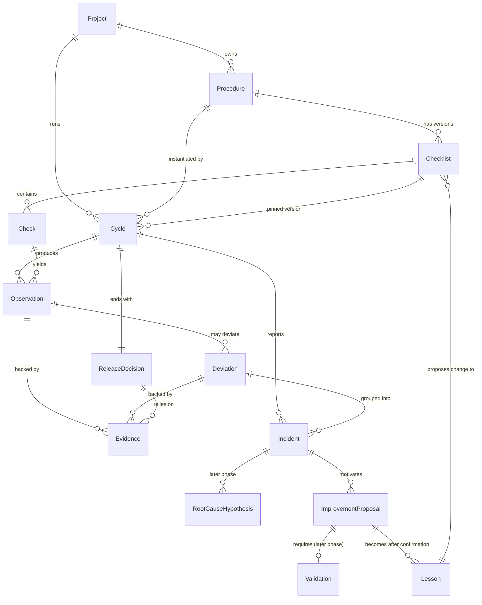
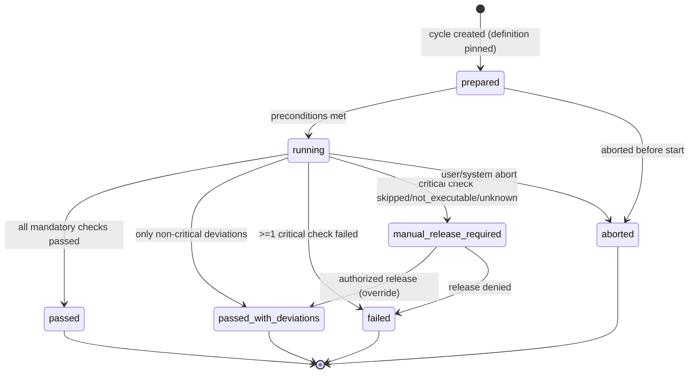
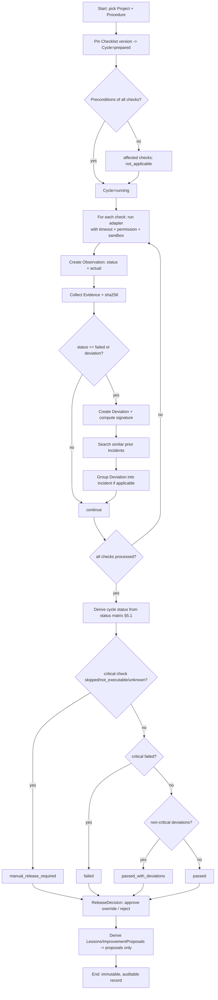

# Kyklos — Analysis & Plan

> 🇩🇪 German translation: [kyklos-analysis-and-plan.de.md](kyklos-analysis-and-plan.de.md).
> This English document is the primary (standard) version; on any divergence it prevails.
>
> First planning document. Date: 2026-10-28. Requirements author: Stefan Werfling. License: MIT.

This document delivers the eight expected results from the brief: repository status,
MVP scope, domain model, cycle flow diagram, example checklist, experience case with
cross-project reuse, risks/security boundaries, and a prioritized implementation plan
with acceptance criteria.

---

## 1. Repository and architecture status (inventory)

**Demonstrably present** (no inventions):

| Element | State |
|---|---|
| Git | 1 commit (`ed51521 Initial commit`), branch `main` |
| Tracked files | only `LICENSE`, `README.md` |
| `package.json` | originally `name: kyklos`, `version: 1.0.0`, `type: commonjs`, no real `test` script, **no dependencies** |
| `README.md` | 2-line stub |
| `LICENSE` | MIT, © 2026 Stefan Werfling |
| `.mcp.json` | `synaipse` knowledge server, scoped project-wide to `kyklos` |
| `.idea/` | JetBrains config (PHP and Node plugins active), not tracked |
| Tests / lint / typecheck / CI | **absent** |
| Source code | **absent** — greenfield |

**Conclusion:** There are no working components that would need to be replaced. We build
from scratch, but follow the **documented conventions of your own projects** (see below)
instead of introducing new ones.

### Conventions from your sibling projects (evidenced)

Derived from `figtree`, `figtree-schemas`, `flyingfish`, `bambooo`:

- **Language/runtime:** TypeScript 5.7, `strict`, `module: NodeNext`, `target: ES2022`,
  build to `dist/` incl. `declaration` (`.d.ts`).
- **Lint:** ESLint 9 with `@typescript-eslint`, `@stylistic/eslint-plugin-ts`,
  `eslint-plugin-prefer-arrow`, `eslint-plugin-import` (legacy `.eslintrc.json`, `eslint:all` base).
- **Tests:** Jest (`ts-jest`) in `flyingfish`/`bambooo`, Vitest in `figtree`.
- **Schema/validation:** `vts` (runtime type validation, OpenSourcePKG) + `vtseditor` for
  schema definition — **already your ecosystem, directly reusable.**

### Name (resolved)

The product is consistently named **Kyklos** (Greek κύκλος, "cycle"). The name "Praxis"
used in the original vision was a mistake and is not used. Code/npm namespace: `@kyklos/*`.

---

## 2. Core technical decisions & open points

| ID | Decision | Choice | Rationale |
|---|---|---|---|
| D1 | Product/package name | **resolved:** consistently `kyklos` / "Kyklos" | "Praxis" was a prompt error |
| D2 | Language/runtime | **resolved:** TypeScript on Node 24 (ESM/NodeNext) | matches your stack 1:1 |
| D3 | Schema layer | **resolved:** `vts` + `vtseditor` | your own tooling, no new dependency |
| D4 | Persistence (MVP) | **resolved:** file-based JSON store (append-only runs, versioned definitions) | deterministic, diff-/review-able, git-friendly |
| D5 | Check execution | adapter pattern with `shell`/`http`/`manual` + declaration checks | pluggable, safe defaults |
| D6 | Test framework | **resolved:** Vitest | smooth with ESM/NodeNext, already used in `figtree` |
| D7 | LLM/semantics | **not in MVP**; deterministic core | brief, Phase 7 |
| D8 | Project language | **resolved:** English standard, German as translation (`*.de`) | user requirement |

D1–D4, D6, D8 are confirmed. D5/D7 are drafts and get refined in their respective
milestones.

---

## 3. MVP scope

**In the MVP (Phase 8 list):**

1. Project & procedure definition (`Project`, `Procedure`).
2. Versioned checklist (`Checklist`, `Check`).
3. Deterministic execution of check steps (runner + adapters).
4. Structured results & evidence (`Cycle`, `Observation`, `Evidence`).
5. Deviation & incident capture (`Deviation`, `Incident`).
6. Simple search for prior incidents (feature/signature matching, **without** AI).
7. Checklist improvement suggestions (`ImprovementProposal`) — proposal only, never auto-activated.
8. Traceable release decisions (`ReleaseDecision`).
9. An example software-release procedure (checklist A–F).
10. Automated tests for critical flows (status logic, gatekeeping, serialization).

**Deliberately NOT in the MVP (later phases):**

- `RootCauseHypothesis` as its own workflow with automatic confidence levels → in the MVP
  only a **data field** on `Incident` (free text + confidence enum), no dedicated lifecycle.
- `Rule` as an independently executable, versioned engine → in the MVP a `Check` is the
  executable unit; `Rule` becomes necessary only once checks are generated from rules.
- `Validation` as a separate object type → in the MVP a **mandatory field on `ImprovementProposal`**
  (a proposal without documented validation stays in status `proposed`).
- `Lesson` abstraction & **cross-project** transfer → data model is prepared, the transfer
  workflow comes in Phase 6 after the MVP.
- Distributed agents, web UI, AI/semantic search, message queues.

**Minimum objects needed in the MVP:** `Project`, `Procedure`, `Checklist`, `Check`, `Cycle`,
`Observation`, `Deviation`, `Evidence`, `Incident`, `ImprovementProposal`, `ReleaseDecision`.
Added later: `RootCauseHypothesis`, `Lesson`, `Rule`, `Validation` (as standalone entities).

---

## 4. Domain model with relationships

### 4.1 Identity & versioning (core principle)

- **Definitions** (`Procedure`, `Checklist`, `Check`, later `Rule`): identified by a stable
  `id` **+ `version`** (SemVer-like or monotonic). Definitions are **immutable**; a change
  produces a new version. Old versions are retained for reproducibility.
- **Events/runs** (`Cycle`, `Observation`, `Deviation`, `Evidence`, `ReleaseDecision`):
  **append-only**, immutable once finished. Identified by ULID/UUID + timestamp.
- **Integrity:** every `Evidence` carries a **checksum (sha256)** over its content; a `Cycle`
  references the exact **definition versions** it ran with. This makes every result exactly
  reproducible and auditable.

### 4.2 Relationship diagram (ER)



### 4.3 Object descriptions

| Object | Purpose | Identity | Key fields | Lifecycle |
|---|---|---|---|---|
| **Project** | project identity & technology | `id` | name, repoUrl, stack/tags, policyRefs | persistent, editable |
| **Procedure** | reusable flow | `id`+`version` | name, kind (release/backup/…), checklistRef | immutable per version |
| **Checklist** | versioned check list | `id`+`version` | checks[], ruleVersion | immutable per version |
| **Check** | single check step | `id`+`version` | preconditions, action(adapter+args), successCriterion, criticality, expectedEvidence, onFailure | immutable per version |
| **Cycle** | concrete execution | ULID | projectRef, procedureRef@ver, state, startedAt/endedAt, results[] | state machine (§5) |
| **Observation** | measured actual state | ULID | checkRef@ver, status, actual, measuredAt, evidenceRefs | append-only |
| **Deviation** | expected/actual mismatch | ULID | observationRef, expected, actual, severity, signature | append-only |
| **Evidence** | verifiable proof | ULID | type (log/test/checksum/file), uri/inline, sha256, producedBy | immutable |
| **Incident** | correlated failure case | ULID | deviationRefs[], classification, signature, status, confidence | open→investigating→resolved |
| **RootCauseHypothesis** *(later)* | possible cause | ULID | incidentRef, statement, evidenceRefs, confidence (direct/correlation/plausible/confirmed) | proposed→(dis)confirmed |
| **Lesson** *(later)* | confirmed insight | `id`+`version` | scope (project/general), statement, conditions, limits, provenance, validationStatus | draft→validated→published |
| **ImprovementProposal** | proposed change | ULID | target (checklist/check), diff, rationale, evidenceRefs, status, validationRef | proposed→validated→accepted/rejected |
| **Validation** *(later standalone)* | effectiveness proof | ULID | proposalRef, method, result, evidenceRefs | pending→passed/failed |
| **Rule** *(later)* | deterministically executable rule | `id`+`version` | expression, severity | immutable per version |
| **ReleaseDecision** | release decision | ULID | cycleRef, outcome (approve/reject/abort), rationale, ruleVersion, decidedBy, overrides[] | immutable |

**Data integrity rules (invariant):**

1. A `Cycle` references **exactly one** pinned `Checklist` version; subsequent checklist
   changes never affect running/finished cycles.
2. Every `Observation` has **exactly one** status from the enum in §5.2.
3. An `ImprovementProposal` can reach status `accepted` **only** if a `Validation` with
   `passed` exists (MVP: mandatory field; later: object).
4. A `ReleaseDecision` with a critical open `Deviation` is only possible with an explicit,
   authorized `override` (justified, signed, logged).

---

## 5. The verification cycle as a controlled flow

### 5.1 Cycle state machine



**Core rule (gatekeeping):** A **skipped, not-executable or unknown critical** check step
**never** automatically leads to `passed`, but at least to `manual_release_required`.
Non-critical deviations lead to `passed_with_deviations`.

### 5.2 Result status per check step (explicitly separated)

`passed` · `failed` · `skipped` · `not_applicable` · `not_executable` · `unknown`

| Status | Meaning | Counts as passed? |
|---|---|---|
| passed | success criterion met | yes |
| failed | success criterion violated | no |
| skipped | deliberately omitted | no (critical → gate) |
| not_applicable | precondition does not apply | neutral |
| not_executable | action could not run (tool missing, timeout) | no (critical → gate) |
| unknown | result cannot be determined unambiguously | no (critical → gate) |

### 5.3 Full flow of a verification cycle



---

## 6. Example: release checklist (versioned, machine-readable)

Excerpt of a `Checklist` v1.0.0 for `kind: software-release` (groups A–F). Deliberately
declarative/YAML, adaptable across projects via `adapter` args.

```yaml
checklist:
  id: release.default
  version: 1.0.0
  ruleVersion: 1.0.0
  checks:
    # --- A. Preparation ---
    - id: prep.target-version
      version: 1.0.0
      group: preparation
      description: Uniquely identify target version and source state
      criticality: critical
      preconditions: []
      action: { adapter: shell, cmd: "git describe --tags --always", timeoutMs: 5000 }
      successCriterion: { kind: regex, on: stdout, pattern: "^v?\\d+\\.\\d+\\.\\d+" }
      expectedEvidence: [stdout]
      onFailure: block

    - id: prep.clean-worktree
      version: 1.0.0
      group: preparation
      description: Git working tree is clean
      criticality: critical
      action: { adapter: shell, cmd: "git status --porcelain", timeoutMs: 5000 }
      successCriterion: { kind: empty, on: stdout }
      onFailure: block

    # --- B. Backup & restore ---
    - id: backup.create
      version: 1.0.0
      group: backup
      description: Create database backup and document the result
      criticality: critical
      action: { adapter: shell, cmd: "${BACKUP_CMD}", timeoutMs: 1800000 }
      successCriterion: { kind: exitZeroAndFileExists, path: "${BACKUP_FILE}" }
      expectedEvidence: [stdout, file:checksum]
      onFailure: block

    - id: backup.verify-integrity
      version: 1.0.0
      group: backup
      description: Verify backup integrity (checksum/test read)
      criticality: critical
      preconditions: [backup.create==passed]
      action: { adapter: shell, cmd: "${BACKUP_VERIFY_CMD}", timeoutMs: 600000 }
      successCriterion: { kind: exitZero }
      onFailure: block

    - id: backup.restore-test
      version: 1.0.0
      group: backup
      description: Restore into a test environment + consistency check
      # A created backup is NO proof of restorability.
      criticality: critical
      preconditions: [backup.verify-integrity==passed]
      action: { adapter: shell, cmd: "${RESTORE_TEST_CMD}", timeoutMs: 1800000 }
      successCriterion: { kind: exitZero }
      expectedEvidence: [stdout, test:report]
      onFailure: block

    # --- C. Upgrade ---
    - id: upgrade.migrate
      version: 1.0.0
      group: upgrade
      description: Run & verify DB migrations from source to target version
      criticality: critical
      preconditions: [backup.restore-test==passed]
      action: { adapter: shell, cmd: "${MIGRATE_CMD}", timeoutMs: 900000 }
      successCriterion: { kind: exitZero }
      expectedEvidence: [stdout, test:migration-log]
      onFailure: block

    - id: upgrade.smoke-business-flows
      version: 1.0.0
      group: upgrade
      description: Test core business flows + API behavior after upgrade
      criticality: critical
      action: { adapter: http, request: { method: GET, url: "${BASE_URL}/health" }, timeoutMs: 15000 }
      successCriterion: { kind: httpStatus, equals: 200 }
      onFailure: block

    # --- D. Rollback (deployment vs. DB rollback vs. full restore) ---
    - id: rollback.plan-defined
      version: 1.0.0
      group: rollback
      description: Recovery strategy defined BEFORE upgrade & irreversible migrations marked
      criticality: critical
      action: { adapter: manual, prompt: "Rollback strategy documented? Irreversible steps named?" }
      successCriterion: { kind: manualConfirm }
      onFailure: block

    - id: rollback.deployment-test
      version: 1.0.0
      group: rollback
      description: Prove return to the previous application version (functional)
      criticality: critical
      action: { adapter: shell, cmd: "${ROLLBACK_TEST_CMD}", timeoutMs: 900000 }
      successCriterion: { kind: exitZero }
      expectedEvidence: [stdout, test:report]
      onFailure: block

    # --- E. Deployment & post-checks ---
    - id: deploy.artifact-integrity
      version: 1.0.0
      group: deployment
      description: Verify artifact integrity & target version
      criticality: critical
      action: { adapter: shell, cmd: "sha256sum -c ${ARTIFACT_SHA_FILE}", timeoutMs: 30000 }
      successCriterion: { kind: exitZero }
      onFailure: block

    - id: deploy.healthcheck
      version: 1.0.0
      group: deployment
      description: Check health checks, logs, error rates, background jobs
      criticality: critical
      action: { adapter: http, request: { method: GET, url: "${BASE_URL}/health" }, timeoutMs: 15000 }
      successCriterion: { kind: httpStatus, equals: 200 }
      onFailure: block

    - id: deploy.error-rate
      version: 1.0.0
      group: deployment
      description: Error rate below threshold after deployment
      criticality: major   # non-critical -> passed_with_deviations possible
      action: { adapter: http, request: { method: GET, url: "${BASE_URL}/metrics/errors" }, timeoutMs: 15000 }
      successCriterion: { kind: jsonPathLte, path: "$.rate", value: 0.01 }
      onFailure: warn

    # --- F. Release ---
    - id: release.gate
      version: 1.0.0
      group: release
      description: Evaluate mandatory checks, present residual risks, document decision
      criticality: critical
      action: { adapter: decision }
      successCriterion: { kind: allCriticalPassed }
      onFailure: block
```

**Notes:** `${…}` are project-specific parameters from the `Project` configuration
(no secrets in plain text in the checklist). `criticality: critical` → the gate applies;
`major/minor` → non-critical. `onFailure: block|warn|escalate` controls the behavior.

---

## 7. Example: experience case with cross-project reuse

**Originating incident (project `flyingfish`):**

1. **Deviation:** `backup.restore-test` → `failed`. Expected: consistent DB after restore.
   Actual: missing foreign-key data. Evidence: `restore.log` (sha256…), `diff-report.txt`.
2. **Incident classification:** `backup/restore`, technology `postgres`, signature
   `restore-incomplete:fk-constraint`. Similar prior incidents: none.
3. **Cause (RootCauseHypothesis, confidence separated):**
   - *Observation (direct):* dump was created with `--data-only` without ordering guarantees.
   - *Plausible hypothesis:* `pg_dump` without `--disable-triggers`/wrong order → FK violation on restore.
   - *Correlation ≠ cause:* the concurrent Node upgrade was **not** causal (ruled out by reproduction).
4. **ImprovementProposal:** extend check `backup.create` with `--format=custom` + restore via
   `pg_restore --clean --if-exists`; new check `backup.restore-fk-consistency`.
5. **Validation (mandatory before activation):** proposal run in a test environment →
   restore successful, FK consistency `passed`. Only **then** status `validated`.

**Abstraction into a general lesson (Phase 6):**

```yaml
lesson:
  id: lesson.pg-restore-fk-consistency
  version: 1.0.0
  scope: general
  statement: >
    Logical PostgreSQL dumps must ensure referential integrity on restore
    (custom format + pg_restore --clean, or disable triggers).
    A successful dump does not prove a successful restore.
  appliesTo: { tech: [postgresql], procedureKind: [software-release, backup] }
  conditions:   # only transfer if satisfied in the target project
    - "Backup mechanism uses pg_dump/pg_restore"
    - "Schema contains foreign keys"
  knownLimits:
    - "Not relevant for physical backups (pg_basebackup)"
  provenance: { originProject: flyingfish, incidentSignature: "restore-incomplete:fk-constraint" }
  validationStatus: validated
  excludes: [secrets, credentials, pii, project-internal-hostnames]
```

**Transfer rule:** The lesson is only proposed to project `helionet` if its `Project.stack`
contains PostgreSQL **and** the `conditions` are checked and confirmed. What is transferred
is the **abstracted rule**, never secrets, hostnames or project-internal data.

---

## 8. Risks & security boundaries

| # | Risk | Boundary / mitigation |
|---|---|---|
| R1 | Skipped critical check counts as passed | Hard gate rule §5.1; covered by critical tests |
| R2 | "Backup created" confused with "restorable" | Separate checks `create`/`verify`/`restore-test`, restore is a mandatory gate |
| R3 | Rollback types confused | Deployment / DB rollback / full restore are separate checks |
| R4 | Arbitrary shell execution (RCE) | Adapter with **allowlist**, defined permissions, **timeout**, controlled execution environment; no implicit secrets |
| R5 | Automatic "learning" alters release criteria | `ImprovementProposal` → proposal only; activation only after `Validation` + authorized acceptance |
| R6 | AI grants release / alters protocols | **forbidden**: no AI decides releases, alters protocols or resets systems |
| R7 | Correlation treated as cause | Confidence levels separated (direct/correlation/plausible/confirmed); reproduction required |
| R8 | Secrets/PII in transferred lessons | `excludes` list, no plain-text secrets, only abstracted general rules |
| R9 | Tampering with evidence | Evidence immutable + sha256; runs append-only; definitions versioned/pinned |
| R10 | Production systems altered by Kyklos | Default read-only/test environment; writing actions only explicit, authorized, logged |

**Non-goals (security):** no automatic publishing, no reset of production systems, no
autonomous release by automation/AI.

---

## 9. Prioritized implementation plan (with acceptance criteria)

> Small, verifiable steps. Each milestone delivers code + tests + green
> `lint`/`typecheck`/`test`/`build`. No large-scale refactorings.

### M0 — Project setup (foundation) ✅ done
- TS setup per your conventions (tsconfig strict/NodeNext/ES2022, `.eslintrc.json` like
  `figtree-schemas`, Vitest).
- Scripts: `build`, `lint`, `typecheck`, `test`. Folder structure `src/`, `test/`.
- Bilingual README (`README.md` EN primary, `README.de.md`).
- **Acceptance (met, verified 2026-10-28):** `npm run build`, `npm run typecheck`,
  `npm run lint`, `npm test` run green (smoke test `KYKLOS_VERSION`).

### M1 — Domain model & serialization
- Types/schemas (via `vts`) for the 11 MVP objects; JSON (de)serialization; sha256 for evidence.
- File-based store (append-only runs, versioned definitions).
- **Acceptance:** round-trip tests (serialize→deserialize identical); definition versioning
  immutable; invalid objects are rejected (schema validation tested).

### M2 — Check runner & adapters ✅ done
- Adapters `manual`, `shell` (allow-list + timeout, no shell string → structured bin/args), `http`
  (fetch + AbortSignal timeout); `SuccessCriterionEvaluator`; `AdapterRegistry`; `CheckRunner`
  (src/Runner). Decision adapter deferred to M3.
- Status mapping (6 statuses) deterministic; a non-executed/unknown check never becomes passed.
- **Acceptance (met, verified 2026-10-28):** all six statuses reproducible via fixtures; timeout →
  `not_executable`; non-allow-listed binary refused; determinism tested; 60 tests green.

### M3 — Cycle engine & gatekeeping ✅ done
- `CycleStateResolver` (gatekeeping), `CycleEngine` (runs checks → Observations/Deviations,
  derives state, optional append-only persistence; injected Clock + IdGenerator for reproducibility),
  `ReleaseGate` (`ReleaseDecision` with authorized/justified/logged override path) — src/Cycle.
- **Acceptance (met, verified 2026-10-28):** property tests over all status combinations —
  skipped/not_executable/unknown **critical** ⇒ never passing, always `manual_release_required`;
  critical `failed` ⇒ `failed`; blocked states never auto-approve without an override; 88 tests green.

### M4 — Example release procedure ✅ done
- `ReleaseExample` (src/Examples): versioned A–E checklist (12 checks), example Project/Procedure,
  `dryRunRegistry()`; `DryRunAdapter` (src/Runner) simulates any adapter kind. Group F = `ReleaseGate`.
- **Acceptance (met, verified 2026-10-28):** full dry run produces an auditable, persisted cycle
  (passed) and an approved decision; §5.3 flow reproduced (failing run → Failed → gate reject →
  override approve; non-critical-only failure → passed_with_deviations); documented in README (EN+DE); 91 tests green.

### M5 — Deviations, incidents & search ✅ done
- `SignatureBuilder` (deterministic fingerprints; wired into `CycleEngine`), `IncidentBuilder`
  (incident from a deviation, confidence separated), `IncidentMatcher` (exact signature/classification,
  no AI), `IncidentRepository` (store-backed save + findSimilar); `FileStore.listRecords` added — src/Learning.
- **Acceptance (met, verified 2026-10-28):** identical signature matches prior incidents; unknown/unrelated
  signature returns none (no false links); results ordered by id (deterministic); 103 tests green.

### M6 — Improvement proposals (proposal only) ✅ done
- `ProposalBuilder` (proposal from incident, starts proposed/pending), `ProposalService`
  (validate/accept/reject; accept gated on `validation=passed`), `ChecklistAmender` (accepted
  proposal → new checklist version, immutable, old retained) — src/Learning.
- **Acceptance (met, verified 2026-10-28):** a proposal without `validation=passed` cannot be
  `accepted` (throws InvalidState); amendment only from an accepted proposal; acceptance creates a
  new checklist **version** (next minor) with the old version retained in the store; 113 tests green.

### M7 — Cross-project lessons ✅ done
- `Lesson` domain object (src/Domain); `LessonSanitizer` (deterministic secret/PII/internal-host
  detection, no AI); `LessonTransfer` (evaluate transfer against a target project) — src/Learning.
- **Acceptance (met, verified 2026-10-28):** a lesson transfers only when validated, required tech is
  in the target stack, and every condition is confirmed; secrets/PII/internal hosts block transfer with
  explainable reasons (tested); 122 tests green.

### Cross-cutting (every milestone)
- Documented interfaces, robust error handling, safe defaults, no unnecessary deps.
- Non-executable checks and residual risks are documented, never counted as passed.

---

## 10. Next step

D1–D4, D6, D8 are resolved. **M0 is done** (verified green). The next milestone is **M1**:
the domain model with `vts` schemas for the 11 MVP objects, JSON (de)serialization with
sha256 evidence checksums, and the file-based store. Results are delivered as reviewable diffs.
